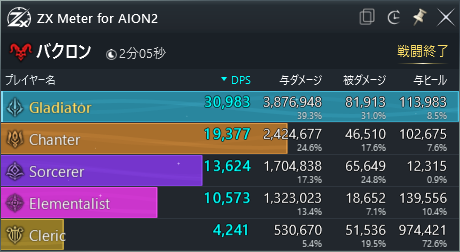

> [!WARNING]
> **AION2の非公式外部ツールです。** 利用は自己責任でお願いします。本ツールの使用によって生じたいかなる問題・損害についても、開発者は一切の責任を負いません。
>
> **二次配布禁止。** 紹介する際はこのページのリンクを共有してください。
> 
> **必ず[配布ページ](https://github.com/rickyzx01/zx-meter-releases/releases/latest)からダウンロードしたインストーラーを使用してください。**
> 第三者から受け取ったファイルには、悪意のある改ざんや不正なプログラムが含まれているおそれがあります。
>
> **サポートは行いません。** ゲームのアップデートなどにより利用できなくなる場合があり、動作の継続や修正・更新は保証しません。

#  ZX Meter for AION2

AION2用のDPSメーターです！プレイヤーごとのDPS・与ダメージ・被ダメージ・与ヒールを計測可能
ツールっぽい地味な見た目が寂しかったので、派手めのエフェクト多めに作りました！

アカウント連携やログイン不要。記録・解析・保存はすべて自分のPC内で完結し、外部への通信やデータ保存は一切行いません

初期状態ではDPS順に並べられ、被ダメージ順、与ヒール順にも変更可能！
さらに、プレイヤー詳細ではスキルごとのダメージ内訳や各種バフの維持率と有効時間、発動区間別のDPSが確認できます！

戦闘は自動記録！過去の戦闘記録は履歴から参照可能
カカシ計測は60秒で自動停止。同じ条件での比較がしやすくなってます！一応手動停止にも対応

そのほか、前面固定・半透明表示・Windows起動時の自動起動機能つき！

## 使用イメージ

バクロン戦の実測データです。プレイヤー名はクラス名に置き換えています。

## ダウンロード

[リリースページ](https://github.com/rickyzx01/zx-meter-releases/releases/latest) · Windows 10 / 11（64ビット）

## インストール

1. インストーラーを実行し、管理者確認で「はい」を選択します。
2. 完了するとメーターが起動します。次回からはデスクトップのアイコンで起動できます。

「WindowsによってPCが保護されました」と表示された場合は、「詳細情報」→「実行」を選択します。

## 更新

最新版のインストーラーを実行すると、自動で更新されます。

## アンインストール

通常のアプリと同様に、Windowsの設定からアンインストールできます。
